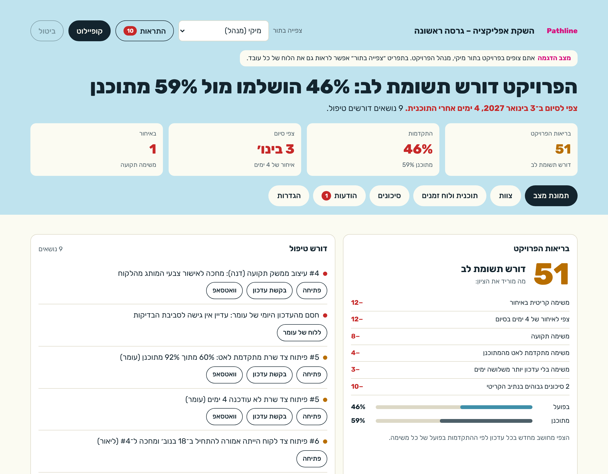
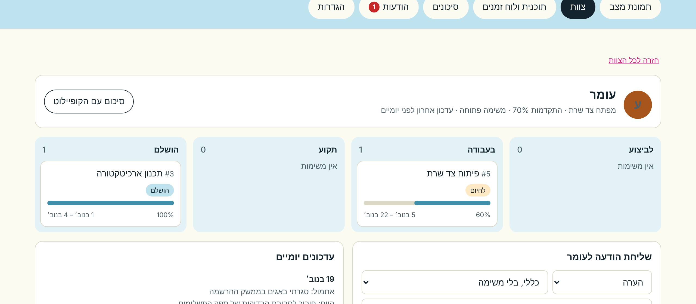
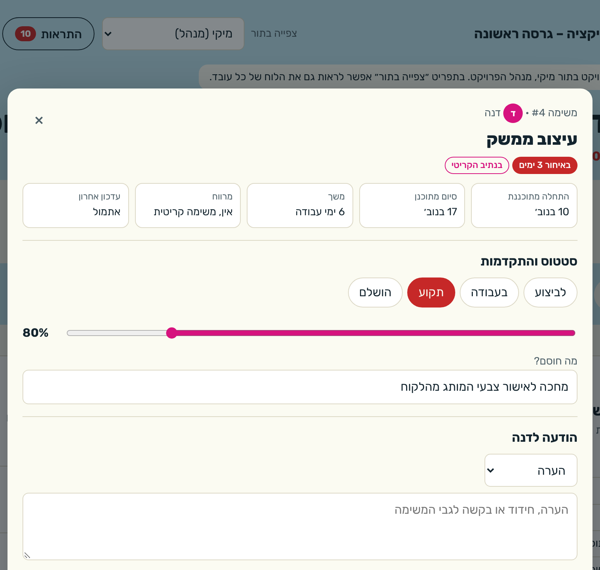
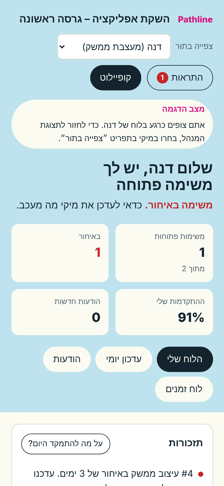
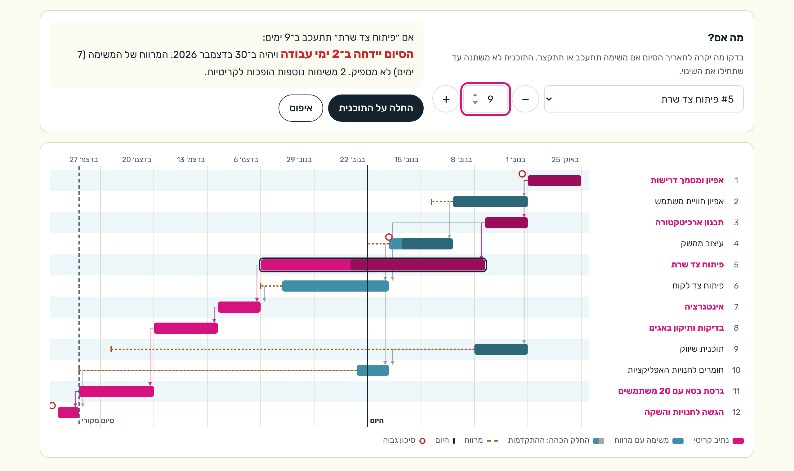
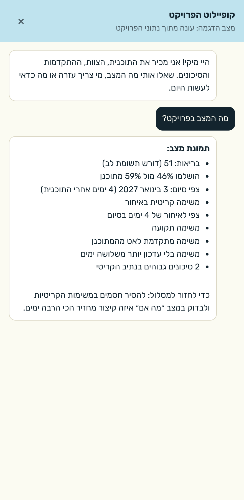

# Pathline – ניהול פרויקטים לצוות

**כלי לניהול פרויקטים שנותן למנהל תמונת מצב חיה, לכל עובד לוח משימות אישי, ולכולם קופיילוט שמכיר את הפרויקט.**

### 🔗 [לצפייה באתר](https://mikelbeizermam.github.io/Pathline/) · 📄 [מסמך האפיון](docs/specification.md)

האתר נפתח במצב הדגמה עם פרויקט מלא: צוות של שישה אנשים, 12 משימות, הודעות, התראות וסיכונים. אתם צופים בפרויקט בתור מנהל הפרויקט, ובתפריט ״צפייה בתור״ אפשר לעבור ללוח של כל עובד.

<picture><source media="(prefers-color-scheme: dark)" srcset="docs/dark/dashboard.png"></picture>

---

## המסלול בעמוד הזה

כמו בנתיב קריטי, כל תחנה מובילה לבאה. אפשר לעבור לפי הסדר או לקפוץ ישר לתחנה שמעניינת אתכם.

<table>
<tr><td width="33%" valign="top">תחנה 1 <b><a href="#על-הפרויקט">על הפרויקט</a></b> מה זה Pathline ולמה השם</td><td width="33%" valign="top">תחנה 2 <b><a href="#הבעיה">הבעיה</a></b> למה צוותים מגלים עיכובים מאוחר מדי</td><td width="33%" valign="top">תחנה 3 <b><a href="#הפתרון">הפתרון</a></b> מה מקבלים המנהל, העובד וכולם</td></tr>
<tr><td width="33%" valign="top">תחנה 4 <b><a href="#מה-אפשר-לעשות-בכלי">מה אפשר לעשות בכלי</a></b> כל היכולות, עם צילומי מסך</td><td width="33%" valign="top">תחנה 5 <b><a href="#איך-זה-עובד-מאחורי-הקלעים">מאחורי הקלעים</a></b> נתיב קריטי, צפי חי וציון בריאות</td><td width="33%" valign="top">תחנה 6 <b><a href="#שני-מצבי-עבודה">שני מצבי עבודה</a></b> הדגמה ב־GitHub וצוות אמיתי ב־Claude</td></tr>
<tr><td width="33%" valign="top">תחנה 7 <b><a href="#טכנולוגיה">טכנולוגיה</a></b> קובץ אחד, בלי שרת, תמיד באוויר</td><td width="33%" valign="top">תחנה 8 <b><a href="#איך-הפרויקט-נבנה">איך הפרויקט נבנה</a></b> חמש איטרציות, כמו מוצר אמיתי</td><td width="33%" valign="top">תחנה 9 <b><a href="#מפת-דרכים">מפת דרכים</a></b> מה מגיע בגרסאות הבאות</td></tr>
</table>

> 📄 **רוצים את כל הפרטים?** [מסמך האפיון המלא](docs/specification.md) כולל פרסונות, סיפורי משתמש עם קריטריוני קבלה, דרישות לפי מודול, כל הכללים העסקיים, הרשאות, מודל נתונים וזרימות.

---

## על הפרויקט

Pathline הוא כלי לניהול פרויקטים שנבנה במיוחד לצוותים בישראל. הוא משלב שלושה דברים שבדרך כלל מפוזרים בין כמה כלים:

1. **תכנון:** לוח זמנים בשיטת הנתיב הקריטי, שמתחשב בשבוע עבודה של ראשון עד חמישי ובחגים בישראל.
2. **ביצוע:** לוח משימות אישי לכל עובד, עדכונים יומיים, הודעות ותזכורות.
3. **בקרה:** תמונת מצב למנהל עם ציון בריאות, צפי סיום חי והתראות על מה שדורש טיפול.

השם מגיע מהמונח ״נתיב קריטי״ (באנגלית Critical Path): שרשרת המשימות שקובעת את תאריך הסיום של הפרויקט. בתרשים הגאנט היא מסומנת בקו ורוד.

---

## הבעיה

בצוותים קטנים ובינוניים, ניהול פרויקט נראה בדרך כלל כך: התוכנית בגיליון אקסל, העדכונים בקבוצת וואטסאפ, והסטטוס בישיבה שבועית. התוצאה:

- **המנהל לא יודע מה המצב בזמן אמת.** עיכוב במשימה קריטית מתגלה רק בישיבה הבאה, כשכבר מאוחר.
- **העובדים לא יודעים מה הכי דחוף.** כל המשימות נראות באותה חשיבות.
- **אין קשר בין סיכונים ללוח הזמנים.** רשימת הסיכונים יושבת במסמך נפרד, וסיכון על משימה עם שבועיים של מרווח מקבל אותה תשומת לב כמו סיכון על משימה קריטית.
- **התאריכים לא מציאותיים.** רוב הכלים הבינלאומיים מניחים שבוע עבודה של שני עד שישי ולא מכירים את החגים בישראל.

---

## הפתרון

Pathline מחבר בין התוכנית לביצוע. כל עדכון של עובד, כמו אחוז התקדמות, חסם או סיום משימה, משנה מיד את התמונה אצל המנהל: את הצפי לסיום, את ציון הבריאות ואת רשימת הנושאים שדורשים טיפול.

| למי | מה הוא מקבל |
|---|---|
| **מנהל הפרויקט** | תמונת מצב חיה, התראות, גישה ללוח של כל עובד, הודעות ומעקבים |
| **עובד בצוות** | לוח משימות אישי, תזכורות על דדליינים, עדכון יומי קצר והודעות מהמנהל |
| **כולם** | קופיילוט שמכיר את כל נתוני הפרויקט ועונה על שאלות |

---

## מה אפשר לעשות בכלי

### תמונת מצב למנהל
- **ציון בריאות** לפרויקט, מ־0 עד 100, עם פירוט של מה שמוריד אותו.
- **התקדמות בפועל מול מתוכנן**, וצפי סיום שמחושב מחדש בכל עדכון.
- **רשימת ״דורש טיפול״:** משימות תקועות, באיחור או מפגרות, משימות שלא עודכנו כמה ימים וחסמים מהעדכון היומי. ליד כל אחת יש כפתורים לפעולה מיידית: בקשת עדכון, שליחה בוואטסאפ ופתיחת המשימה.
- **מפת עומס שבועית** שמראה מי מחזיק יותר מדי משימות במקביל.
- **דוח סטטוס שבועי** שנוצר אוטומטית מהנתונים ומוכן לשליחה.
- **מעקבים אישיים:** תזכורות למנהל עם תאריך, כמו ״לבדוק עם הלקוח את אישור העיצוב״.

### הצוות ולוח המשימות האישי

<picture><source media="(prefers-color-scheme: dark)" srcset="docs/dark/team-board.png"></picture>

- כרטיס לכל עובד עם ההתקדמות שלו, משימות באיחור ועדכון אחרון. לחיצה פותחת את הלוח שלו.
- לוח משימות בארבעה שלבים: לביצוע, בעבודה, תקוע והושלם.
- **חלון משימה** שבו מעדכנים סטטוס ואחוז התקדמות, כותבים מה חוסם ושולחים עדכון. יש בו גם כפתור להוספת הדדליין ליומן.
- **עדכון יומי** בשלוש שאלות: מה עשיתי אתמול, מה אעשה היום ומה חוסם אותי. הוא מחליף את ישיבת הבוקר, וחסם שנכתב בו מופיע אצל המנהל כהתראה.

<picture><source media="(prefers-color-scheme: dark)" srcset="docs/dark/task.png"></picture> <picture><source media="(prefers-color-scheme: dark)" srcset="docs/dark/mobile.png"></picture>

### תזכורות והודעות
- **התראות לפי תפקיד.** העובד מקבל התראה על דדליין היום או מחר, על משימה שהגיע הזמן להתחיל ועל עדכון שחסר. המנהל מקבל התראה על חסמים, איחורים ומעקבים.
- **הודעות** מסוג הערה, חידוד, בקשת עדכון או משימה חדשה, לעובד מסוים או לכל הצוות. אפשר להגיב ולסמן כנקרא.

### תכנון ולוח זמנים

<picture><source media="(prefers-color-scheme: dark)" srcset="docs/dark/plan.png"></picture>

- **חישוב נתיב קריטי** ותרשים גאנט מימין לשמאל, עם קו ״היום״ ועם ההתקדמות של כל משימה.
- **מצב ״מה אם״:** בוחרים משימה ומספר ימי עיכוב או קיצור, ורואים מיד איך זה משפיע על תאריך הסיום ואילו משימות הופכות לקריטיות.
- **תבניות** לפיתוח אפליקציה, השקת אתר, הפקת אירוע והטמעת מערכת בארגון. בוחרים רק את המשימות שרלוונטיות לפרויקט.
- **עריכה מלאה של התוכנית:** כשמוחקים משימות, התלויות מתחברות מחדש מעצמן.
- **לוח עבודה ישראלי:** שבוע עבודה של ראשון עד חמישי, דילוג על ימי שבתון וימי חופש של החברה.

### ניהול סיכונים
- מטריצת סיכונים בגודל 5 על 5 שמסננת את הרשימה.
- **תרגיל פרה־מורטם:** מדמיינים שהפרויקט נכשל, וכל סיבה הופכת לסיכון.
- סימון של סיכונים שנמצאים על משימות בנתיב הקריטי.

### קופיילוט

<picture><source media="(prefers-color-scheme: dark)" srcset="docs/dark/copilot.png"></picture>

צ׳אט שזמין לכל המשתמשים ומכיר את כל נתוני הפרויקט: משימות, התקדמות, סיכונים, הודעות ועדכונים יומיים. המנהל יכול לשאול ״מי מאחר ולמה?״ ועובד יכול לשאול ״על מה להתמקד היום?״. השאלות המוצעות משתנות לפי התפקיד.

---

## איך זה עובד מאחורי הקלעים

**נתיב קריטי.** המשימות ממוינות לפי סדר התלויות ביניהן. מעבר קדימה מחשב לכל משימה את ההתחלה והסיום המוקדמים, ומעבר אחורה מסוף הפרויקט מחשב את המאוחרים. ההפרש ביניהם הוא המרווח, ומשימות בלי מרווח הן הנתיב הקריטי.

**צפי סיום חי.** הצפי מחושב מחדש לפי מה שקרה בפועל:
- משימה שהושלמה נגמרת בתאריך המתוכנן, או היום אם הסתיימה מוקדם.
- משימה בעבודה נגמרת היום ועוד החלק שנשאר לה.
- משימה שעוד לא התחילה מתחילה לא לפני היום ולא לפני המשימות שהיא תלויה בהן.

**ציון בריאות.** מתחיל ב־100 ויורד לפי משימות קריטיות באיחור, צפי לאיחור בסיום, משימות תקועות, משימות מפגרות, משימות בלי עדכון וסיכונים גבוהים בנתיב הקריטי. מעל 75 הפרויקט במסלול, בין 50 ל־74 הוא דורש תשומת לב, ומתחת ל־50 הוא בסיכון.

**לוח עבודה.** המשך של כל משימה נמדד בימי עבודה. כל יום עבודה ממופה לתאריך לפי ימי השבוע שנבחרו, החגים בישראל וימי החופש של החברה.

---

## שני מצבי עבודה

אותו קובץ עובד בשני מצבים:

| | מצב הדגמה | מצב צוות |
|---|---|---|
| **איפה** | האתר הזה, ב־GitHub Pages | בתוך Claude |
| **נתונים** | נשמרים בדפדפן של המבקר | מאגר משותף לכל הצוות |
| **משתמשים** | מעבר בין המנהל לכל עובד מהתפריט | כל עובד נכנס עם החשבון שלו |
| **קופיילוט** | עונה מתוך נתוני הפרויקט | מחובר ל־Claude ועונה על כל שאלה |

---

## טכנולוגיה

- **קובץ אחד** שכתוב ב־HTML, CSS ו־JavaScript, בלי ספריות חיצוניות ובלי שלב בנייה.
- **שכבת אחסון כפולה:** מאגר משותף כשהוא זמין, ואחסון בדפדפן בכל מקום אחר.
- **אלגוריתמים:** מיון לפי תלויות (אלגוריתם Kahn), חישוב נתיב קריטי וזיהוי תלות מעגלית.
- **ממשק:** כתיבה מימין לשמאל, התאמה מלאה לטלפון ומצב כהה.
- **אחסון:** GitHub Pages. אין שרת שנרדם ואין מסד נתונים שנסגר, ולכן האתר זמין תמיד.

---

## איך הפרויקט נבנה

הפרויקט נבנה באיטרציות, כמו מוצר אמיתי. בכל שלב הוגדרה בעיה, נבנה פתרון ונאסף משוב:

1. **גרסה ראשונה:** חישוב נתיב קריטי ותרשים גאנט, יחד עם ניהול סיכונים שמקושר למשימות.
2. **התאמה לשוק הישראלי:** ממשק בעברית מימין לשמאל, שבוע עבודה של ראשון עד חמישי וחגים.
3. **מצב ״מה אם״:** כלי לקבלת החלטות. מה קורה לתאריך הסיום אם משימה מתעכבת?
4. **מעבר לכלי צוות:** לוח אישי לכל עובד, תמונת מצב למנהל, תזכורות, הודעות, עדכון יומי וקופיילוט.
5. **ליטוש:** הפרדה בין צבע ״קריטי״ לצבעי ״בעיה״, ציון בריאות בצבעי רמזור ובדיקות אוטומטיות לכל כפתור.

את מסמך הדרישות, סדרי העדיפויות וההחלטות על חוויית המשתמש קבעתי אני. את הקוד כתבתי בעבודה משותפת עם Claude, כלי בינה מלאכותית.

---

## מפת דרכים

- התראות במייל ובטלפון
- השוואה בין תוכנית הבסיס לביצוע בפועל לאורך זמן
- ניהול תקציב ושעות עבודה
- ייצוא לוח הזמנים לקובץ PDF ולגיליון
- הודעות פרטיות ברמת הרשאות

---

**מיקי בייזרמן** · סטודנט למנהל עסקים ומערכות מידע בקריה האקדמית אונו · ניהול מוצר וניהול פרויקטים

